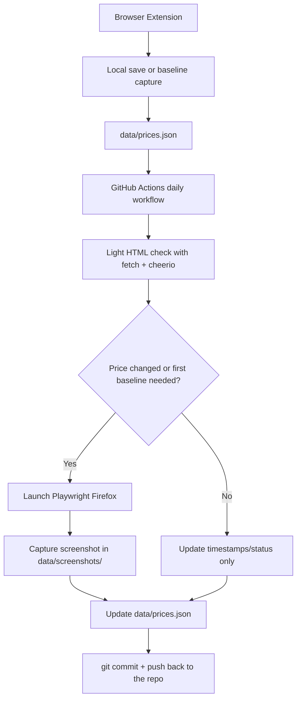

# pricePatrol

pricePatrol is a self-hosted, open-source price monitoring project built for GitHub repos and forks.

The repository is the source of truth:

- `data/prices.json` stores the tracked products and the latest known state
- `data/screenshots/` stores reference screenshots
- GitHub Actions runs the checks once per day and commits any data changes back to the repo

## Architecture



### Why this design

- **No always-on polling server**: the old 1-minute interval loop is removed.
- **Daily automation**: GitHub Actions runs the monitor once per day and on demand.
- **Fast first pass**: the workflow first uses plain HTML fetch + `cheerio`.
- **Stable browser automation**: GitHub Actions uses standard Playwright Firefox instead of a custom browser wrapper, which is more reliable in CI.
- **Repo-backed storage**: snapshots and screenshots are committed directly into the repository, so forks stay portable.

## Repository layout

- `backend/` – Node.js backend, monitor runner, storage helpers, and optional local dashboard/API
- `extension/` – browser extension used to capture or seed product references
- `data/` – versioned state used by the workflow
- `.github/workflows/check-prices.yml` – daily monitor workflow

## How the daily workflow works

1. GitHub Actions starts once per day via cron, or manually via `workflow_dispatch`.
2. The monitor loads the tracked products from `data/prices.json`.
3. It performs a lightweight HTML request and extracts the price with `cheerio`.
4. If the product has no previous baseline, the workflow records the initial reference:
   - saves the price metadata
   - launches Playwright Firefox
   - captures a screenshot into `data/screenshots/`
5. If a tracked price differs from the last stored reference, the workflow captures a new screenshot and updates the reference.
6. The workflow commits the updated `data/` files and pushes them back to the same repo or fork.

## Local development

### Option 1: Docker

```bash
docker compose up --build
```

Then open:

- `http://localhost:3001/`
- `http://localhost:3001/api/health`

The Docker setup mounts `./data` into the container, so local runs update the same repo-backed files.

### Option 2: Node.js

Requirements:

- Node.js 20+
- npm

Run:

```bash
cd backend
npm install
npm start
```

## Browser extension

Load the `extension/` folder as an unpacked extension.

### Chrome / Edge / Brave

1. Open `chrome://extensions` or `edge://extensions`
2. Enable **Developer mode**
3. Click **Load unpacked**
4. Select the `extension/` folder

### Firefox

1. Open `about:debugging#/runtime/this-firefox`
2. Click **Load Temporary Add-on**
3. Select `extension/manifest.json`

Use the extension to save the current product page and create the first tracked reference.

### Extension settings

Open the extension **Settings** page and configure:

- GitHub repository: `owner/repo` format, for example `Veselincho/pricePatrol`
- GitHub Personal Access Token with repository write access
- Branch name, if your default branch is not `main`

The extension writes directly to `data/prices.json` through the GitHub REST API and then dispatches the daily workflow to take the first baseline screenshot in the cloud.

## GitHub Actions setup

For the workflow to commit back into the repository, GitHub must allow write access for Actions.

### Required repository setting

In your GitHub repository:

1. Go to **Settings**
2. Open **Actions** → **General**
3. Under **Workflow permissions**, select **Read and write permissions**
4. Save the setting

The workflow itself also declares:

```yaml
permissions:
  contents: write
```

That allows the built-in `GITHUB_TOKEN` to commit and push changes back to the repo.

### Fork usage

If someone forks the project:

1. They enable Actions in the fork
2. They keep **Read and write permissions** enabled
3. The daily workflow will update their fork’s `data/` files independently

## New product / first baseline flow

A product is considered uninitialized when there is no stored price reference yet.
On the next workflow run, pricePatrol will:

- read the page HTML
- extract the current price
- create the initial baseline record
- capture the first screenshot

That baseline becomes the comparison point for later daily runs.

## Publishing to GitHub

1. Create a new empty GitHub repository.
2. Initialize git locally in this project.
3. Commit the current files.
4. Add the GitHub remote and push to `main`.
5. Enable GitHub Actions with **Read and write permissions**.
6. Wait for the first daily run or trigger the workflow manually.

## Notes

- Keep `data/prices.json` and `data/screenshots/` under version control.
- The backend server is optional for local testing; daily automation is handled by GitHub Actions.
- Screenshots are stored as repo-relative paths, so they work cleanly in forks and in committed JSON data.
